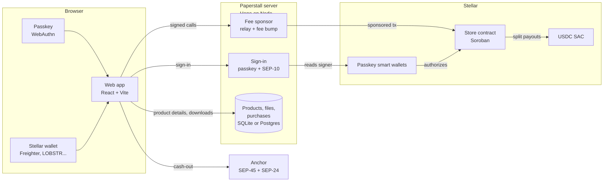

# Paperstall

**Sell what you make to buyers anywhere. Get paid in dollars on Stellar the moment a sale happens.**

A creator store for Nigeria and Ghana, built for the Stellar Buildathon (Builder's Circle). Creators list templates, ebooks, courses and beat packs; buyers pay in USDC with a passkey or any Stellar wallet; a Soroban contract pays the creator, co-creators, the affiliate and the platform in the same transaction; creators keep dollars or cash out through a Stellar anchor.

> **Live demo (testnet): https://paperstall.onrender.com** · [demo shop](https://paperstall.onrender.com/c/demo)
>
> **Status:** works end to end on Stellar testnet with Circle's testnet USDC: listing, two ways to pay, downloads, affiliates, co-creator splits, sign-in on any device, creator shops and cash-out through the SDF test anchor. Mainnet needs a funded fee sponsor and a deployed store contract (see [Mainnet](#mainnet)).

## Try it

Open **https://paperstall.onrender.com** (free hosting: after a quiet spell the first visit takes up to a minute to wake the server). The [demo shop](https://paperstall.onrender.com/c/demo) has three real products made for it (a drum sample pack, an invoice template and a checklist, all CC0) to buy with test USDC. Or run it locally (below). Then, in about two minutes:

1. **Sell:** open `/sell`, create a wallet with your fingerprint or face, upload any file, set a price and a co-creator, and sign the listing.
2. **Buy:** open the product in another browser profile. Either make a passkey wallet and press **Get 10 test USDC**, or press **Pay with a Stellar wallet** and use Freighter, LOBSTR, xBull or Albedo on testnet. Pay, and download.
3. **Earn:** back on `/dashboard`, the sale is there with its transaction. Name your shop, pause or reprice a product, pay out a co-creator's held share, or cash out through the anchor.

## The problem

Creators in Nigeria and Ghana (designers, tutors, coders, musicians) earn by selling digital products. The demand is proven: Selar reports paying about ₦18 billion to roughly 400,000 creators in 2025. Getting paid is still slow and lossy:

- payouts wait for processing and stall at weekends
- sales to buyers abroad lose value when converted to naira or cedis
- affiliates and collaborators wait for, or argue about, their share

## What Paperstall does

| | |
|---|---|
| **Instant split payouts** | One Soroban contract takes the buyer's USDC and, in the same transaction, pays the platform fee, up to 5 co-creators, the affiliate who referred the buyer, and the creator. Nobody holds anyone's money. |
| **Pay with a passkey** | A buyer with no crypto makes a wallet with a fingerprint or face: no app, no seed phrase, no XLM. |
| **Pay with a Stellar wallet** | Freighter, LOBSTR, xBull, Albedo, Hana, Rabet and others through Stellar Wallets Kit. The store pays the network fee with a fee-bump transaction. |
| **No fees in XLM, ever** | A fee sponsor pays every network fee under strict rules, so passkey wallets never hold XLM. |
| **Receipts unlock downloads** | The sale recorded on chain is the receipt. The server checks it before serving a file, and gives the buyer a private link that works on any device. |
| **A library on any device** | Buyers sign in with the passkey or Stellar wallet they paid with and find everything they bought. |
| **Shops** | Each creator gets a shop page (`/c/yourname`) with their name, bio and products. |
| **Dashboard** | Balance with a naira and cedi estimate, every sale with its transaction, edit, reprice or pause products, pay out co-creators' held shares, send USDC anywhere. |
| **Cash out** | Sign in to a Stellar anchor with the passkey wallet (SEP-45), fill in bank details on the anchor's own page (SEP-24), and send it the USDC. |

## How it uses Stellar

| Stellar piece | Where | What it does here |
|---|---|---|
| Soroban smart contract | [`contracts/store`](contracts/store/src/lib.rs) | Lists products, splits each sale, records receipts, holds undeliverable shares until claimed |
| USDC (Stellar Asset Contract) | [`src/config.ts`](app/src/config.ts) | Prices and settlement in Circle's USDC |
| Passkey smart wallets | [`src/wallet.ts`](app/src/wallet.ts) | OpenZeppelin smart accounts with a WebAuthn signer, via [smart-account-kit](https://github.com/stellar/smart-account-kit) |
| Fee sponsorship | [`server/sponsor.ts`](app/server/sponsor.ts), [`server/policy.ts`](app/server/policy.ts) | Our relayer submits passkey-signed calls; Stellar wallet purchases are wrapped in fee-bump transactions |
| Stellar Wallets Kit | [`src/stellarWallet.ts`](app/src/stellarWallet.ts) | Checkout and sign-in for Freighter, LOBSTR, xBull, Albedo and more |
| SEP-10 style sign-in | [`server/auth.ts`](app/server/auth.ts) | A Stellar wallet signs a challenge transaction that can never be submitted |
| WebAuthn against on-chain signers | [`server/auth.ts`](app/server/auth.ts) | Passkey sign-in on any device, checked against the public key stored in the wallet's contract |
| SEP-1, SEP-45, SEP-24 | [`src/anchor.ts`](app/src/anchor.ts) | Anchor discovery, sign-in for contract accounts, interactive withdrawal |
| Muxed addresses (CAP-67) | [`src/anchor.ts`](app/src/anchor.ts) | A contract wallet can't attach a memo, so the anchor's memo ID travels inside an M-address |
| Smart-account indexer | [`server/births.ts`](app/server/births.ts) | Finds a passkey wallet on a new device. Our server fills in creation records the public indexer hasn't caught up with; the kit verifies them on chain |

## Architecture



What lives where:

- **On chain:** prices, splits, the platform fee locked into each product, every sale and receipt, held shares, all balances.
- **On the server:** titles, descriptions, files and covers, shop names, and a record of purchases made through the store (for the sales feed and the library). The server never holds funds or keys other than the fee sponsor's.

## The contract

[`contracts/store`](contracts/store/src/lib.rs) (Rust, Soroban SDK 29). One contract holds every product.

- `create_product(creator, price, shares, affiliate_bps)` lists a product with up to 5 co-creators on fixed shares. The platform fee in force at that moment is locked into the product.
- `buy(buyer, product_id, affiliate)` takes the price in one transfer and pays the fee, the co-creators, the affiliate and the creator in the same transaction. The creator gets the remainder, so rounding never loses a unit. It stores the receipt and refuses a second purchase of the same product.
- If a recipient can't receive USDC yet (no trustline, or frozen), their share is held instead of failing the sale; `claim(to)` pays it later, and anyone may call it because it only ever pays `to`.
- `update_product` changes the price or pauses sales. Shares can't change after listing, so a creator can't cut out a co-creator.
- Admin: `set_fee` (capped at 10%, new listings only), `set_admin`, `upgrade`.
- 19 unit tests. A buyer's signature covers the exact price, so a creator can't change the price between quote and payment.

```sh
cargo test                     # 19 unit tests
stellar contract build
./scripts/testnet-e2e.sh       # deploys a fresh store on testnet and runs a real split sale
```

### On testnet

Store contract [`CD6MR5EW…A3ZU`](https://stellar.expert/explorer/testnet/contract/CD6MR5EWSIJ6GOMKZ6UUP53SECPCMU6LRA7PW3XYBUMGCM3AQ5YAA3ZU), with Circle's testnet USDC and a 5% platform fee. A scripted 10 USDC sale with a 20% co-creator who had no trustline yet and a 10% affiliate:

| | USDC |
|---|---|
| Buyer paid | 10.00 |
| Platform fee | 0.50 |
| Affiliate | 1.00 |
| Creator | 6.50 |
| Co-creator: held at sale, claimed after adding a trustline | 2.00 |

[Sale](https://stellar.expert/explorer/testnet/tx/972038f5914edad8c8ac96eb2cae80e7eb7ade599af8734ded4a24983143a0e7) · [claim](https://stellar.expert/explorer/testnet/tx/d40f124171bc41492c0f176e92ae6767be3ee0a43fb6f6ea87adc297d5d92105)

## Trust and security

**What the fee sponsor pays for** ([rules](app/server/policy.ts), [tests](app/tests/policy.test.ts)):

- deploying a passkey wallet from the approved OpenZeppelin account code only;
- `buy`, `create_product`, `update_product` and `claim` on our store, and a smart wallet sending its own USDC;
- a Stellar wallet's own `buy` or `claim`, wrapped in a fee bump: exactly one call, for itself, signed by itself.

It refuses anything the sponsor would authorize just by paying (source-account credentials), any call where the sponsor would be a signer, other contracts and functions, and anything whose resource fee is above 0.5 XLM. It simulates before paying, so a failing purchase costs nothing. Rate limits are kept in the database, so they survive restarts.

**How the server knows who you are.** A browser proves it controls a wallet by one of:

- submitting through the server a transaction that wallet signed, which then succeeds on chain;
- signing a one-time passkey challenge, which the server checks against the public key stored in the wallet's own contract (`get_context_rule`), with the origin, relying party and user-verification flags;
- signing a SEP-10 style challenge transaction with a Stellar wallet.

Challenges are single use and expire in 5 minutes. Proven wallets go in a signed, HTTP-only cookie.

**Downloads.** A download link is an HMAC of the product and the buyer, like Gumroad's or Selar's private links. The server checks the on-chain receipt each time before serving the file.

**Finding a wallet on a new device.** smart-account-kit looks a passkey up in an indexer, then checks the wallet's creation transaction on chain itself. The public indexer can take a long time to record a new wallet's creation, so a creator who had just made one couldn't sign in on their phone. Our server records the creation of every wallet it sponsors and answers lookups in the indexer's format, passing anything else to the public indexer. The kit trusts none of it without checking the chain.

**Moderation.** The contract lets only a product's creator change or pause it, and nobody can stop a sale made on chain. The operator can still take a listing off Paperstall's own shelf and shop pages (`HIDDEN_PRODUCTS`, a list of product ids); people who bought it keep their downloads.

**Known limits.** The smart-account code and smart-account-kit are new and not yet audited. Receipts are kept on chain for 30 days after each sale and then archived; the server's own purchase record then stands in until the entry is restored.

## Cash-out, honestly

On testnet, cash-out uses the Stellar Development Foundation's test anchor (`testanchor.stellar.org`), which supports SEP-45 sign-in for contract accounts and SEP-24 USDC withdrawals: the USDC really leaves the wallet, the bank payout is simulated, and naira and cedi figures are mid-market estimates ([Exchange Rate API](https://www.exchangerate-api.com)).

For mainnet we checked the live ramps on 14 Nov 2026:

- **LINK** (`ngnc.online`, NGNC) runs SEP-24 naira withdrawals to Nigerian banks, but takes NGNC only and signs in classic accounts only (no SEP-45 yet). Its cedi asset GHSC is listed as pending.
- **MoneyGram Ramps** takes USDC directly over SEP-24, but needs the wallet's domain allowlisted, and we could not confirm Nigeria or Ghana payout.
- None of the NGN or GHS ramps we found accepts a contract (passkey) account today.

So on mainnet a creator can already send USDC to any Stellar wallet or exchange from the dashboard (muxed addresses carry memo IDs), and the anchor flow switches on by setting the anchor's domain once a naira anchor accepts SEP-45. We are asking LINK and MoneyGram about it.

## The app

[`app/`](app) is the web app (Vite, React, TypeScript) and its server (Hono on Node). Data lives in SQLite locally and in Postgres when `DATABASE_URL` is set; uploads go on disk locally and in Postgres when hosted.

### Run it

```sh
cd app
pnpm install
pnpm test        # 29 unit tests: sponsor rules, sign-in checks, wallet records, the database
pnpm test:cashout # a passkey wallet cashes out through the SDF test anchor (SEP-45 + SEP-24)
pnpm test:e2e    # the whole store on testnet, in headless Chromium with virtual passkeys
```

To try it yourself with your own fingerprint or face:

```sh
SPONSOR_SECRET=$(stellar keys show cs-sponsor) FAUCET_SECRET=$(stellar keys show cs-faucet) pnpm api   # terminal 1
pnpm dev                                                                                            # terminal 2
```

Then open http://localhost:5173. The sponsor needs testnet XLM (`stellar keys fund cs-sponsor --network testnet`); the faucet account needs testnet USDC.

### The end-to-end test

`pnpm test:e2e` starts the server and the app and drives five people through real testnet transactions:

1. A creator makes a passkey wallet and lists a 300 KB file for 3 USDC with a 20% co-creator (whose wallet can't hold USDC yet) and a 10% affiliate.
2. A buyer arrives through the affiliate's link, makes a passkey wallet, takes test USDC from the faucet, pays and downloads.
3. A second buyer pays from a Stellar wallet: funds it with Friendbot, adds USDC, pays with the fee bumped by the store.
4. The creator signs in on a second device with the same passkey, sees both sales, pays out the co-creator's held share once they add a trustline, pauses and resumes the product, and names their shop.
5. The first buyer signs in on another device and downloads from their library.

`APP_URL=https://paperstall.onrender.com pnpm test:e2e` runs the same people and checks against a deployed site instead; the test listing is paused at the end so it leaves the shelf. On 14 Nov 2026 all 27 checks passed against the live site.

It checks:

- the bytes match the upload
- the saved link works in another browser
- a browser that didn't buy gets no link, and a forged link is refused
- the Stellar wallet paid no XLM for its purchase
- the dashboard figures, and the shop page
- on chain: creator, affiliate, co-creator and both buyers' balances, both receipts, and no XLM in any passkey wallet

### Deploy

[`render.yaml`](render.yaml) is a Render blueprint for one free web service. Give it a Postgres `DATABASE_URL` (a free Neon database works), `PUBLIC_URL`, and testnet `SPONSOR_SECRET` and `FAUCET_SECRET`.

The live demo runs exactly this: a free Render web service and a free Neon Postgres database, both in Frankfurt, deployed on every push to `main`. Its sponsor and faucet are testnet accounts of their own; the faucet holds test USDC bought on the testnet DEX. `APP_URL=… pnpm seed:demo` stocks a new site's demo shop through the site itself (a virtual passkey lists the products, then a buyer pays with faucet USDC and the download is checked).

### Mainnet

1. Deploy the store: `./scripts/deploy-store.sh mainnet <admin> <fee-account>` (the admin needs a few XLM).
2. Fund a fee sponsor account with XLM (about 0.04 XLM per sale on testnet).
3. Point the app at mainnet: Circle's USDC (`GA5ZSEJY…KZVN`), the mainnet WebAuthn verifier for stellar-accounts v0.8.0 (`CB7HENHJ…Q5YR`, from smart-account-kit's [deployment record](https://github.com/stellar/smart-account-kit/blob/main/docs/deployments-stellar-accounts-0.8-2026-10-25.md)), a mainnet RPC, and the new store id. Leave `FAUCET_SECRET` unset.

## Business model

A percentage of each sale, taken by the contract at checkout and set below what creator platforms charge today (5% on testnet, capped at 10% by the contract).

## After the buildathon

- Naira cash-out on mainnet with an anchor that accepts passkey wallets
- Card checkout for buyers without crypto
- Creators in Ghana and Kenya

## License

MIT
